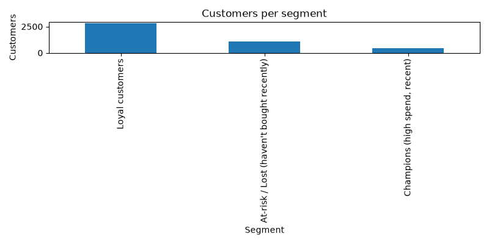
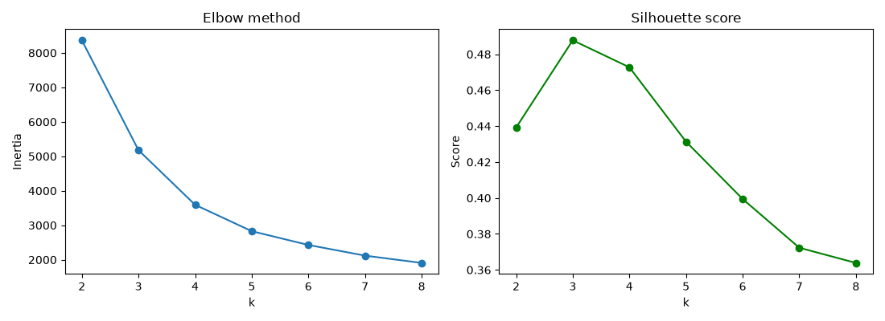

# AI Customer Segmentation Platform

Segments online retail customers into behavior-based groups using RFM analysis and K-Means clustering, so a business can target each group with the right marketing action.

## Problem
Businesses treat all customers the same. This project groups customers by how recently, how often and how much they buy.

## Dataset
[UCI Online Retail dataset](https://archive.ics.uci.edu/dataset/352/online-retail): about 540,000 transactions from a UK online store (2010-2011). Download it and place it at `data/online+retail/Online Retail.xlsx`.

## Method
1. Clean data (remove missing customer IDs, duplicates, cancelled orders)
2. Calculate RFM: Recency, Frequency, Monetary
3. Scale features
4. Choose k with the elbow method and silhouette score (best k = 3)
5. Cluster with K-Means and name each segment

## Results
| Segment | Customers | Avg. recency (days) | Avg. orders | Avg. spend |
|---|---|---|---|---|
| Champions | 458 | 19.6 | 17.7 | 11,787 |
| Loyal customers | 2,797 | 45.1 | 3.2 | 1,077 |
| At-risk / Lost | 1,083 | 245.9 | 1.5 | 439 |




## Suggested actions
- **Champions:** VIP rewards and referral offers
- **Loyal customers:** bundles and loyalty points
- **At-risk / Lost:** win-back discount emails

## How to run
```bash
python -m venv venv
venv\Scripts\activate
pip install pandas scikit-learn matplotlib openpyxl
python segmentation_starter.py
```

## Roadmap
- [ ] Flask web app with login and CSV upload
- [ ] Interactive dashboard (Chart.js)
- [ ] LLM-generated marketing insights
- [ ] SQL database for analysis history
- [ ] Live deployment